

# 🖼️ AI-in-One dashboard v2.0.0: Report Screenshots

### A picture tour of all 17 report pages, in order

**[⬅️ Back to README](README.md)** &nbsp;·&nbsp; **[📘 Interpretation Guide](AI-in-One-v2.0.0-Interpretation-Guide.pdf)** &nbsp;·&nbsp; **[🎞️ Storyboard](AI-in-One-v2.0.0-Storyboard.pptx)** &nbsp;·&nbsp; **[⬇️ Download the dashboard](README.md#-choose-your-edition)**

> [!NOTE]
> Every screenshot uses **made-up example data**. The numbers show how the pages work; they aren't benchmarks or targets for your organization.

Download the **PBIT template** for your edition. These screenshots use the made-up sample files with **Minimum Group Size 1** so the optional detail and navigation can be illustrated. The templates still default to **3** for team-level reporting; use **1** for real data only with approval.

This tour shows what each page looks like and what it's for, so you know where to go for each question. For deeper guidance on reading the numbers, use the **[Interpretation Guide](AI-in-One-v2.0.0-Interpretation-Guide.pdf)**. To present the dashboard to leaders, use the **[Storyboard](AI-in-One-v2.0.0-Storyboard.pptx)**.

## 🗺️ Jump to a page

| Area | Pages |
|---|---|
| 🧭 **Start here** | [1 · Copilot Usage Explorer](#page-1) |
| 🔍 **Copilot overall** | [2 · License Prioritization](#page-2) · [3 · Combined Trends](#page-3) &nbsp;·&nbsp; [4 · Combined Leaderboard](#page-4) |
| 🤖 **Agents** | [5 · Usage Trends](#page-5) &nbsp;·&nbsp; [6 · Habit Formation](#page-6) &nbsp;·&nbsp; [7 · Leaderboard](#page-7) &nbsp;·&nbsp; [8 · Health Check](#page-8) &nbsp;·&nbsp; [9 · Use Cases](#page-9) &nbsp;·&nbsp; [10 · Agent Details](#page-10) |
| 📈 **M365 Copilot** | [11 · Usage Trends](#page-11) &nbsp;·&nbsp; [12 · Habit Formation](#page-12) &nbsp;·&nbsp; [13 · Leaderboard](#page-13) |
| 📊 **Copilot Chat** | [14 · Usage Trends](#page-14) &nbsp;·&nbsp; [15 · Habit Formation](#page-15) &nbsp;·&nbsp; [16 · Leaderboard](#page-16) |
| 📖 **Reference** | [17 · Metric Glossary & Guide](#page-17) |

New to the report? Start with **[Getting around the report](#getting-around)**.

---

## 🧭 Getting around the report

<table>
<tr>
<td width="34%" valign="top">

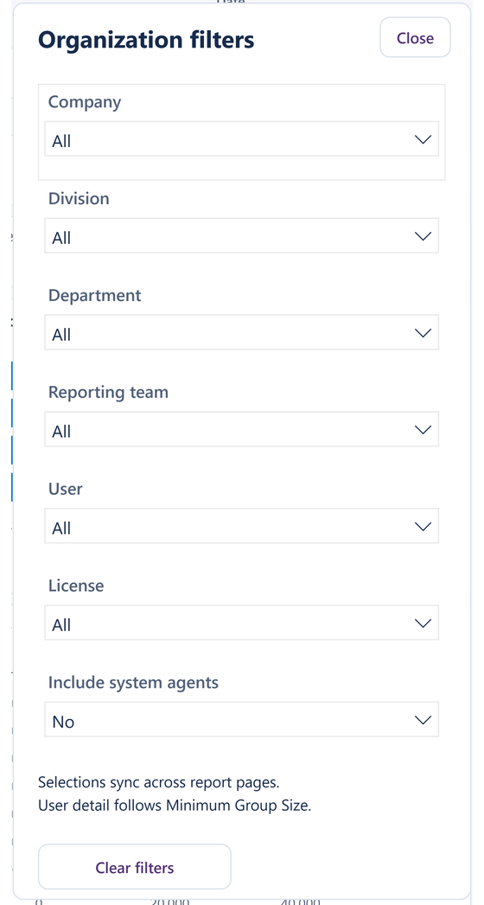

</td>
<td width="66%" valign="top">

These controls work the same way on every analytical page.

- 🎛️ **Org filters:** opens the organization panel. Choose company, division, department, reporting team, user and license. **Include system agents** defaults to **No** in the current template. Your choices follow you from page to page.
- 🔎 **Reporting team:** search for a manager to include everyone in their organization: direct and indirect reports.
- 🧹 **Clear filters:** resets your selections and any expanded tables, without leaving the page.
- 📅 **Date:** drag the slider or type dates to choose the period.
- 🟢 **Activity status:** tells you how many people are in scope, and explains when a group is too small to show or has no recorded activity.
- 🖱️ **Ctrl + click:** in Power BI Desktop, hold **Ctrl** when you select a report button. In Power BI Service, a normal click works.
- ❔ **Help and coverage:** hover over headline help for context. Prompt-count footers link to Microsoft's explanation of audit-log versus Viva/MAC coverage and timing.

</td>
</tr>
</table>

> [!TIP]
> **Minimum Group Size** decides how much detail you see. The default, **3**, keeps reporting at team level; a group needs at least three eligible people before its detail appears. Views that list individual people, such as **By user**, appear only when the report owner approves a setting of **1**.

## Observed history across the report

All **17 existing report pages** use the shared temporal model; observation history does not add a report page. Matching Users and activity inputs count stable people, not state `UserKey` rows. Organizational scope uses each person's latest organization; activity is attributed to the license state in effect at the event, not simply the latest snapshot.

**First seen** means a dated observation, not a license assignment timestamp. Monthly paid membership includes people with a licensed state at any point in that month. Paid and free populations can overlap during a period; count distinct people rather than adding them. Unknown stays Unknown, and collection does not reconstruct unobserved changes.

The existing person hierarchy and row-level security still determine whose data a viewer can see. **Minimum Group Size** remains **3** by default; individual detail requires an approved **1**. On existing person rows, the hidden **License timeline - First seen** tooltip shows the selected person's recorded states, subject to those same access and identity rules. **User License Timeline** is a general **Metric Glossary & Guide** definition, not a separate report page.

For file-based editions, use matching approved PAX append runs with `-UserHistory On` to collect prospective observations. Existing parameters and paths do not change. History Off and one-state inputs preserve snapshot behavior.

**Reporting roots:** a blank PAX **Manager_UserKey** is authoritative top of chain. If a requested manager cannot be found in the file, that person becomes a root; their reports keep their hierarchy. Any missing-manager diagnostic belongs to that person only, not their descendants.

---

## 1 · 🧭 Copilot Usage Explorer

> **The question it answers:** *How is my team, a manager's organization or one agent using Copilot right now?*

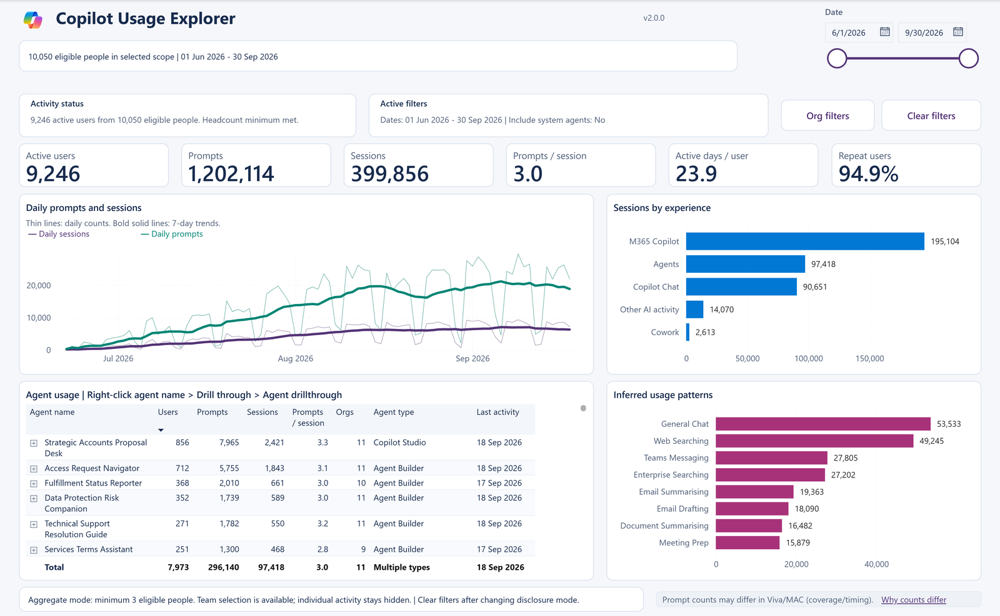

**What you'll see**
- **Six headline numbers:** active users, prompts, sessions, prompts per session, active days per user and repeat users.
- **Daily prompts and sessions:** thin lines show each day; bold lines show the 7-day average. Matching dots mark each month start on the bold trends, not on weekend daily dips.
- **Activity by experience:** switch between sessions and prompts for M365 Copilot, agents, Copilot Chat, other AI activity, unclassified activity and Cowork.
- **Agent usage:** every agent your selected people used, with users, prompts, sessions, organizations, type and last activity.
- **Inferred usage patterns:** possible tasks such as searching, meeting prep or drafting. **Not enough activity to infer** is an explanation, not an invented activity category.

> 💡 **Try this:** Open **Org filters → Reporting team**, type a few letters of a manager's surname and pick their team. Then right-click any agent name and choose **Drill through → Agent drillthrough** to see that agent's details for the same team and dates.

<a href="#top">⬆️ Back to top</a>

---

## 🔍 Copilot overall

*Licensing and side-by-side comparisons across every Copilot experience*

## Prioritization and monthly comparisons

**License Prioritization** separates paid/free directory and activity counts, with independent **Paid activity** and **Free Chat activity** selections. Use **Departments** for ranked department comparisons, or **People & chart** for the existing view and protected person search. **Clear filters** resets the new selectors and person selection too.

**Sessions** remains the default priority-score metric. Choosing **Prompts** substitutes prompt units into the same 10/5/5 benchmarks and 60/30/10 weights: 60% weekly volume / 10, 30% active days per week / 5 and 10% volume per active day / 5. The score is uncapped, not a percentage, a productivity measure or an automatic licensing decision. Individual ranks remain employee-only; blank manager/department ranks have no rank background.

On **Combined Trends**, switch to **Monthly comparison** for paid/free totals, distinct active people and per-active-person ratios in each temporal month/cohort population, not today's directory cohort applied to every month. It respects the dates, organization, license, access and eligible-headcount rules. Weekly-only rank controls do not change monthly totals. With observed license history, cohort membership can overlap; a distinct total can be smaller than the sum of paid and free counts.

**Keep the interpretation consistent:**

- Responses per prompt is unavailable: current PAX messages are prompt-only. Responses would need an explicit producer contract, response identity and parent-prompt linkage; no response metric is implied.
- Habit bands stay fixed at **1–5 / 6–10 / 11–15 / 16+** distinct active days in the displayed month. Zero-day users are outside these bands.
- Inferred activities use stored PAX behavior labels from resource/action/context/plugin/app-host evidence and sometimes agent-name keywords. Leading patterns use the most agent sessions, with alphabetical ties. They do not analyze prompt text, apply AI inference or measure outcomes.
- Other AI examples include non-agent **autonomous** and **logic app** hosts, with blank identity labels. The unchanged sample has no Unclassified rows; unfamiliar-host/unknown-license rule examples are hypothetical.
- The unchanged sample's **7,973** agent users are **5,829 paid + 2,144 free**, with no overlap in that sample. That is not a universal rule once observed history is present. “Most organizations” means departments reached: the sample maximum is **11**, with **Access Help Center** first alphabetically among **134** tied agents.

## 2 · 📊 License Prioritization

> **The question it answers:** *Which groups show usage patterns that could support a licensing conversation?*

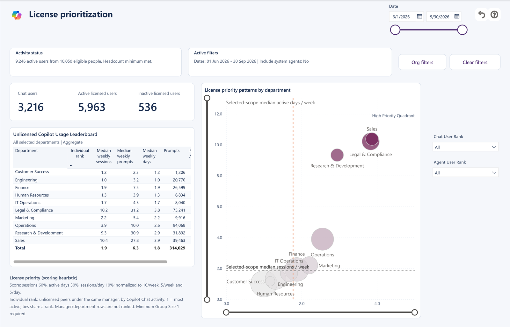

**What you'll see**
- **Unlicensed Chat Users, active licensed users and inactive licensed users** at a glance. Active licensed includes any recorded experience, including agent-only activity; active plus inactive equals licensed directory headcount in the selected scope.
- **Unlicensed Copilot usage leaderboard:** departments ranked by how much people without a Microsoft 365 Copilot license use Copilot Chat, with median weekly sessions and active days.
- **License priority patterns:** choose median weekly sessions or prompts. The vertical axis, selected-scope median reference and scale follow that choice; the horizontal axis remains active days per week.
- **How the score works:** the existing heuristic gives 60% to sessions per week divided by 10, 30% to active days per week divided by 5 and 10% to sessions per active day divided by 5. Scores are not capped; these benchmarks are not validated targets.

> ⚖️ **Good to know:** Use this page to *start* a licensing conversation, alongside job needs, cost and feedback from colleagues. It doesn't decide who should receive a license. Department comparisons come first; individual rankings need an approved setting.

<a href="#top">⬆️ Back to top</a>

## 3 · 🔍 Copilot Overall: Combined Trends

> **The question it answers:** *How do M365 Copilot, Copilot Chat and agents compare over time?*

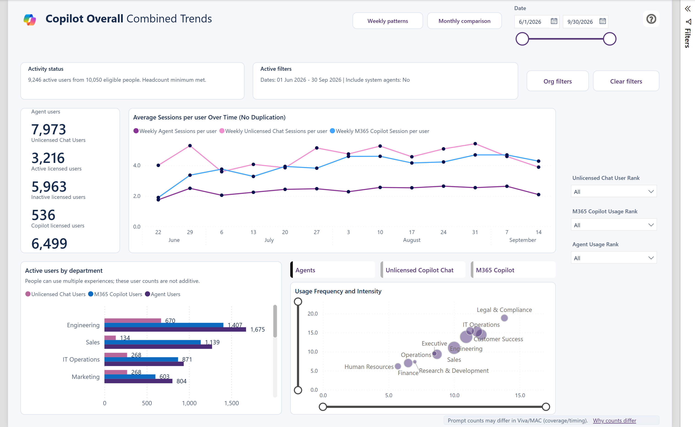

**What you'll see**
- **Agent users, Unlicensed Chat Users, active licensed users, inactive licensed users and licensed directory headcount** in one column. Licensed activity includes every recorded experience; group dividers clarify the comparisons.
- **Average sessions per user over time:** one line each for agents, unlicensed Copilot Chat and M365 Copilot.
- **Active users by department:** separate bars for each experience, not stacked totals.
- **Usage frequency and intensity:** a bubble chart of departments, with tabs to switch between agents, unlicensed Copilot Chat and M365 Copilot.

> ⚖️ **Good to know:** One person can use more than one experience, so these groups overlap. Compare them side by side rather than adding them together.

<a href="#top">⬆️ Back to top</a>

## 4 · 🔍 Copilot Overall: Combined Leaderboard

> **The question it answers:** *Which departments use each experience, and how many chat users also use agents?*

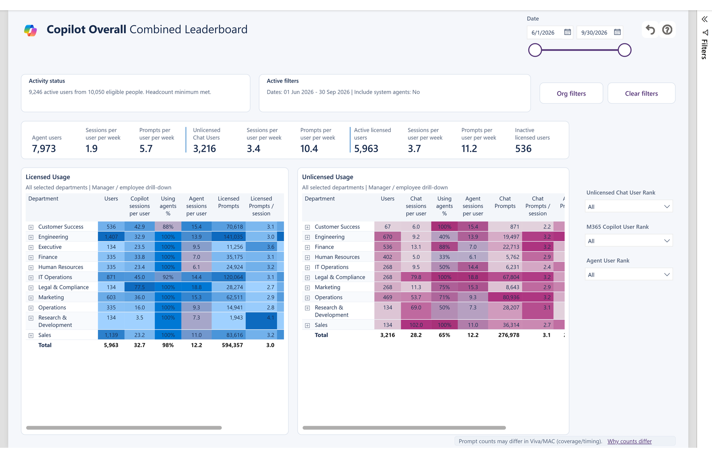

**What you'll see**
- **Licensed usage by department:** users, prompts, prompts per session, weekly prompt/session comparisons, the share who also used agents, and agent activity.
- **Unlicensed usage by department:** chat users, prompts, prompts per session, weekly prompt/session comparisons and the share who also used agents.
- **Heat colors** that make the busiest departments easy to spot.

> ⚖️ **Good to know:** Each percentage answers one question: *of this table's chat users, how many also used agents?* People with unknown license information aren't counted as unlicensed. Agent prompts and prompts per session also follow that table's licensed or chat minimum-group check. Department results come first; individual people appear only with an approved setting.

<a href="#top">⬆️ Back to top</a>

---

## 🤖 Agents

*Reach, habits, leaders, health and uses of every agent in your organization*

## 5 · 🤖 Agents: Usage Trends

> **The question it answers:** *How many people try agents, and how many come back?*

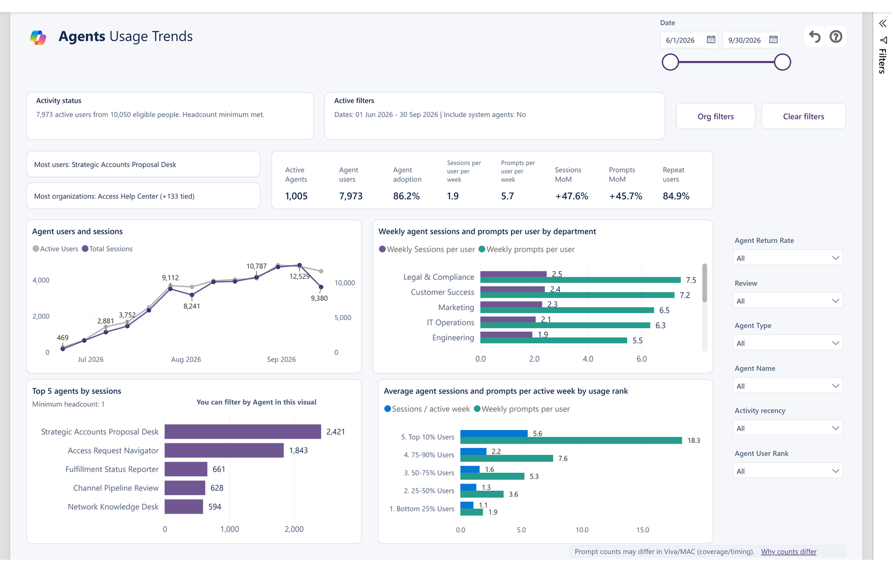

**What you'll see**
- **Most users** and **Most organizations:** which agents lead, with ties shown.
- **Headline numbers:** active agents, agent users, agent adoption, weekly prompts and sessions per user, month-over-month change in prompts and sessions, and repeat users.
- **Agent users, total sessions and total recorded prompts over time:** people use the left axis; session/prompt counts share the right axis. The department comparison shows **weekly agent prompts and sessions per user**.
- **Top 5 agents by sessions.** Hover over an agent for its gated description and type; select it to filter the page.
- **Average agent sessions and prompts per active week by usage rank:** paired bars compare usage bands with the same design as the licensed Copilot page. Per-user and per-active-week labels distinguish the units.
- **Filters on the right** for return rate, review status, agent type, agent name, activity recency and user rank.

> 💡 **Try this:** Compare reach (people who tried an agent) with repeat use (people who came back) over several weeks, then open **Agent Details** to look closer at one agent.

<a href="#top">⬆️ Back to top</a>

## 6 · 🤖 Agents: Habit Formation

> **The question it answers:** *How often do people use agents in a month?*

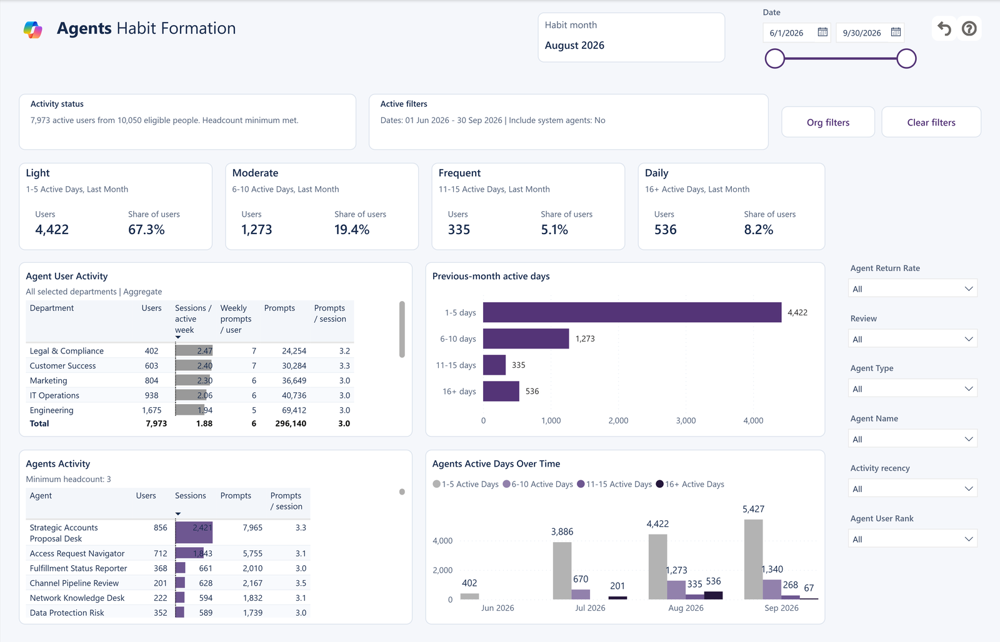

**What you'll see**
- **Habit month**, printed at the top. It's the month before the end of your selected date range.
- **Four habit cards:** Light (1–5 active days), Moderate (6–10), Frequent (11–15) and Daily (16 or more), each with the number and share of people.
- **Previous-month active days:** bars that compare the four groups directly.
- **Agent user activity by department** and **agent activity** tables for your whole selected period.
- **Agent active days over time:** how the habit mix changes month by month.

> ⚖️ **Good to know:** The cards and bars describe the printed habit month. The tables cover your whole selected period, so read them separately.

<a href="#top">⬆️ Back to top</a>

## 7 · 🤖 Agents: Leaderboard

> **The question it answers:** *Which agents, and which people, lead on sessions and prompts?*

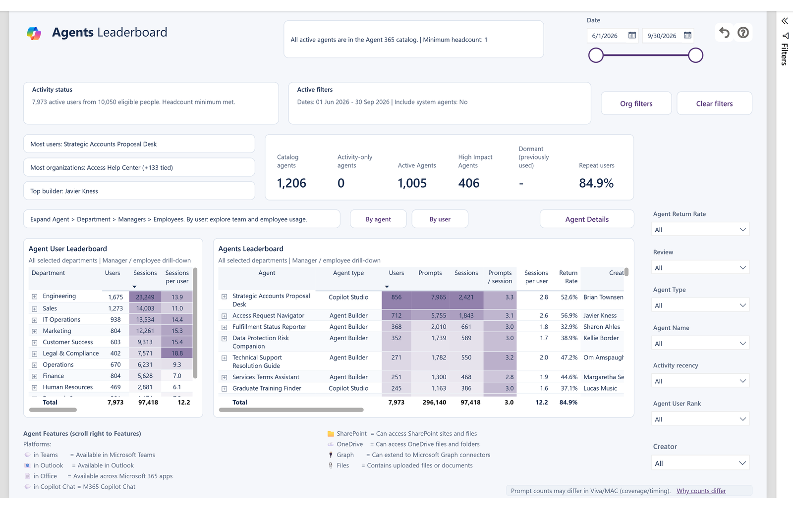

**What you'll see**
- **Headline numbers:** catalog agents counted by Title ID, separately labeled activity-only agents, active agents, high impact agents, dormant agents and repeat users.
- **Agents leaderboard:** each agent's type, users, organizations, sessions, prompts, prompts per session, sessions per user, return rate, Creator, Developer Name, Description, Features, catalog status and usage coverage. Scroll horizontally for the metadata and Features columns.
- **Readable numbers:** Sessions / user and Return Rate use dark text on white. A 0% return rate means active users but no repeat users; a blank means no activity or a protected scope.
- **Explicit catalog defaults:** missing Creator is **Not recorded**; missing or generic Developer Name is **Not stated**; missing or ambiguous Description is **Agent description unavailable.** Creator and Developer Name are catalog metadata, not individual usage, so they remain visible at Minimum Group Size 3 and 1 within the viewer's access.
- **Expandable agent rows:** move from an agent to its departments; manager and employee levels require approved individual detail.
- **By agent** and **By user** buttons. **By user** appears only when individual detail is approved.
- **Agent features:** listed support for M365 Copilot Chat, Teams, Outlook or Office, and capabilities such as SharePoint, OneDrive, Graph connectors and files. Listed support is not proof of use.
- **Catalog status:** distinguish agents in the catalog, activity-only agents and ambiguous matches without mixing those states into the build-platform label.
- **Include system agents:** the synchronized control in **Org filters** defaults to No. Choose Yes to include system-generated entries.
- **Top builder and Creator:** the headline remains stable when an agent is selected. The Creator filter includes matching catalog agents with no usage; numeric activity still follows the minimum and access rules.
- **Agent User Leaderboard:** **Most used agent** chooses the highest-session agent within that row, with an alphabetical name tie-break. **Agents used** counts distinct agents in the same scope. Scroll right; individual rows still require approved detail.
- **Dormant:** previously used agents whose last recorded activity is more than 60 days before the selected end date. Agents with no recorded usage in scope are **No usage** or **Never Used**, not Dormant.

> 💡 **Try this:** Sort by **prompts per session** to find agents that hold longer conversations, then select **Agent Details** to understand who uses them.

<a href="#top">⬆️ Back to top</a>

## 8 · 🤖 Agents: Health Check

> **The question it answers:** *Which agents should we keep, and which should we review with their owners?*

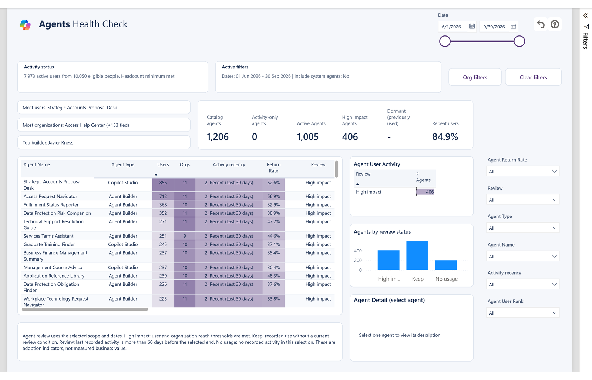

**What you'll see**
- **Catalog agents and Activity-only agents:** separate ID-based counts; agent names need not be unique.
- **Every agent with an explanation:** **High impact**, **Keep**, **Review** or **No usage** for tracked agents. Microsoft Security Copilot entries show **Usage not tracked here**; included system agents show **System-generated**, not an action-oriented review label.
- **Activity recency:** agents grouped by how recently anyone used them.
- **Users, organizations and return rate** for each agent, following your team and date choices.
- **Creator and Developer Name:** separate catalog attributes, available in aggregate and individual modes. Missing values display **Not recorded** and **Not stated**, respectively. Generic developer placeholders also display **Not stated**.
- **Agents by review status:** a chart of how many agents fall into each label.
- **Agent Detail:** select an agent to read its description.
- **Type versus status:** build platform is separate from catalog matching. Third-party store agents identify their publisher in Developer Name rather than a creator in your tenant.

> 💡 **Try this:** Choose a department and period, read the review explanation on the page, then talk through any surprising label with the agent's owner.

<a href="#top">⬆️ Back to top</a>

## 9 · 🤖 Agents: Use Cases

> **The question it answers:** *What might each agent be used for?*

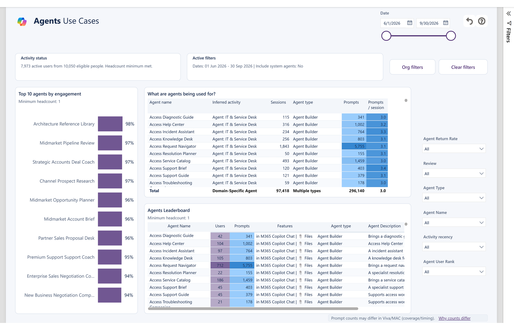

**What you'll see**
- **Top 10 agents by engagement:** agents need at least **MAX(Minimum Group Size, 5)** users in the selected scope. For each eligible agent, compare return rate, sessions per user and prompts per session with the eligible peers; average the three percentile ranks equally. Higher scores reflect stronger repeat use and conversation depth, not measured business value. Sessions descending, then agent name ascending, break ties.
- **Hover context:** users, sessions, prompts and prompts per session remain available in the Top 10 tooltip.
- **What are agents being used for?:** each agent with its likely activity categories, conversation counts and type.
- **Agents leaderboard:** users, prompts, listed capabilities, type and description.

> ⚖️ **Good to know:** Activity categories are clues, not measured outcomes. Choose an agent you know and check them with the people who use it.

<a href="#top">⬆️ Back to top</a>

## 10 · 🤖 Agent Details

> **The question it answers:** *Who uses this agent, how much, where, and do they come back?*

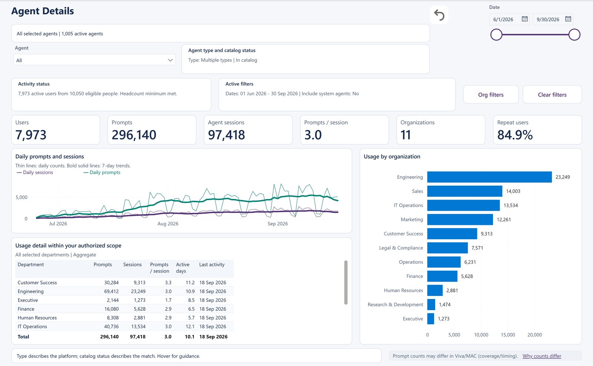

**What you'll see**
- **Agent picker:** starts with all agents; choose one or several.
- **Six headline numbers:** users, prompts, agent sessions, prompts per session, organizations and repeat users.
- **Daily prompts and sessions:** daily lines with bold 7-day averages.
- **Usage by organization:** which departments use the agent most.
- **Usage detail:** departments (and, when approved, people) with prompts, sessions, active days and last activity.

> 💡 **Two ways in:** Open the **Agent Details** tab to browse freely. The Leaderboard **Agent Details** button and **Drill through → Agent drillthrough** open the clicked agent's scoped page. Its selector intentionally stays within that drillthrough filter. The visible note and **Open Agent Details** button provide a route to the full list, keeping organizational and date scope. **Back**, right-click drillthrough and **Clear filters** retain their existing roles.

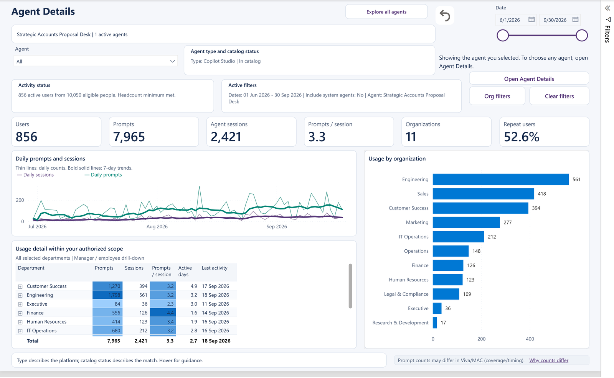

<a href="#top">⬆️ Back to top</a>

---

## 📈 M365 Copilot

*Use of licensed Microsoft 365 Copilot*

## 11 · 📈 M365 Copilot: Usage Trends

> **The question it answers:** *How is licensed Microsoft 365 Copilot use trending?*

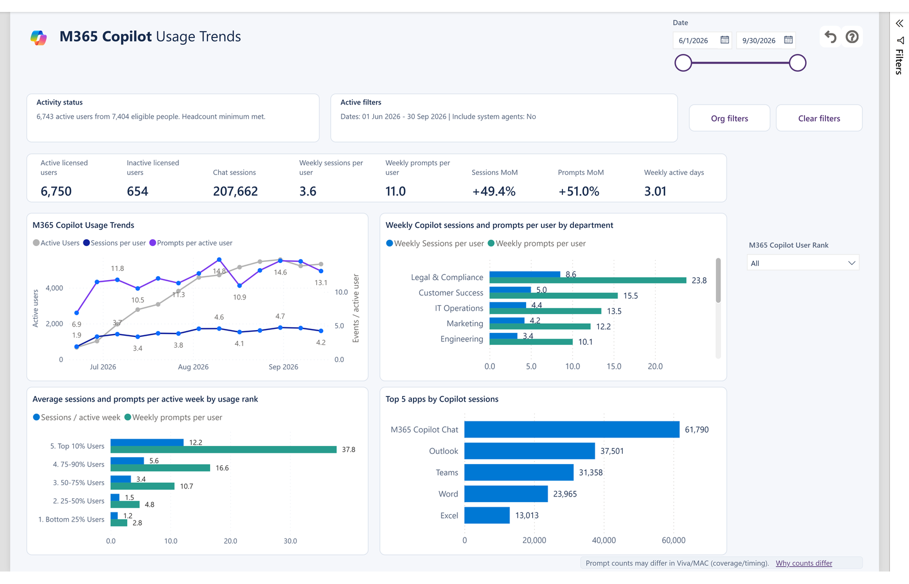

**What you'll see**
- **Headline numbers:** active licensed users, inactive licensed users, Copilot sessions, weekly prompts and sessions per user, prompt/session month-over-month change and weekly active days.
- **Usage trend:** active users on the left axis, with sessions and recorded prompts per active licensed chat user on the right, using the same week/date context. These rates are not additionally divided by active weeks.
- **Weekly prompts and sessions per user by department.**
- **Average prompts and sessions per active week by usage rank:** from the top 10% of users to the bottom 25%. Bands use distinct prompts per active week and recalculate with the selected dates and population.
- **Top 5 apps by Copilot sessions,** such as M365 Copilot Chat, Outlook, Teams and Word.

> ⚖️ **Good to know:** Look at users, sessions and apps together, and ask the team what explains a change before drawing conclusions about value.

<a href="#top">⬆️ Back to top</a>

## 12 · 📈 M365 Copilot: Habit Formation

> **The question it answers:** *Is licensed Copilot becoming a monthly habit?*

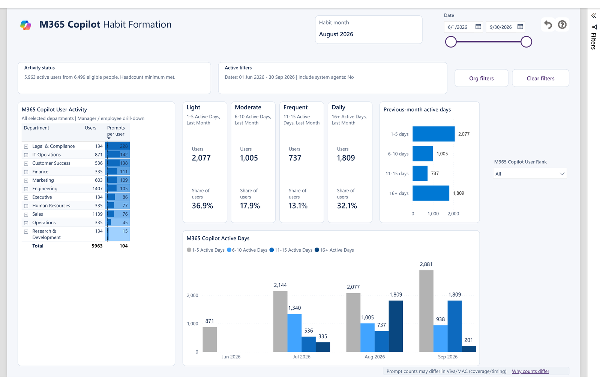

**What you'll see**
- **Habit month**, printed at the top: the month before the end of your selected date range.
- **Light, Moderate, Frequent and Daily cards,** using the same four active-day ranges as every habit page.
- **Previous-month active days:** bars comparing the four groups.
- **M365 Copilot user activity by department** for your whole selected period: the unchanged Users and Prompts per user columns plus **Sessions**, using the existing licensed chat definition. Department, reporting-level and total rows calculate distinct sessions in their own context; they do not sum person/license-state rows.
- **M365 Copilot active days:** the habit mix month by month.

<a href="#top">⬆️ Back to top</a>

## 13 · 📈 M365 Copilot: Leaderboard

> **The question it answers:** *Which departments and apps lead in licensed Copilot use?*

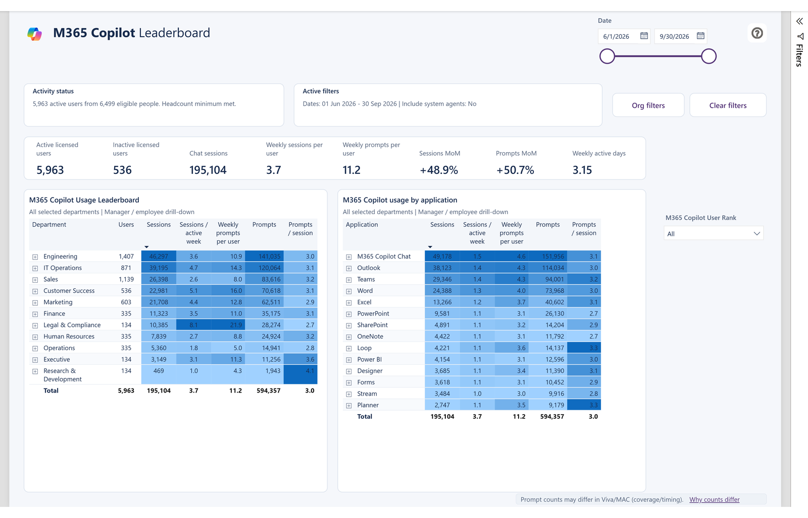

**What you'll see**
- **Usage leaderboard by department:** users, prompts, prompts per session, sessions and weekly prompt/session comparisons, with heat colors.
- **Usage by application:** expand an app to see its departments and, when approved, the people using it.
- **Dynamic rank filter** to focus on usage bands within the selected dates and organization/team/license scope, respecting the viewer's access.

> 💡 **Try this:** Expand **M365 Copilot Chat** (bizchat) and then a department to see where that app is used most.

<a href="#top">⬆️ Back to top</a>

---

## 📊 Copilot Chat

*Copilot Chat use by people without a Microsoft 365 Copilot license. The tabs are explicitly named **Copilot Chat (Unlicensed)**.*

## 14 · 📊 Copilot Chat (Unlicensed): Usage Trends

> **The question it answers:** *How often do people without a Copilot license use Copilot Chat, and do they come back the same day?*

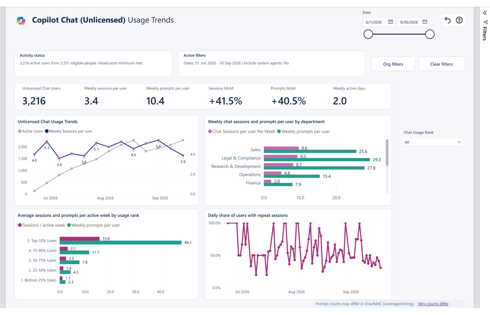

**What you'll see**
- **Headline numbers:** chat users, weekly prompts and sessions per user, prompt/session month-over-month change and weekly active days.
- **Unlicensed chat usage trends:** active people on the left axis; sessions and recorded prompts per user per active week on the right. Each person's volume is divided by their active weeks before averaging across active unlicensed Chat users. The department comparison retains **weekly chat prompts and sessions per user**.
- **Average prompts and sessions per active week by dynamic usage rank.**
- **Daily share of users with repeat sessions:** how many active people had more than one chat session that day.

> ⚖️ **Good to know:** More conversations can mean useful work, retries or a hard task. Read repeat use alongside the weekly pattern.

<a href="#top">⬆️ Back to top</a>

## 15 · 📊 Copilot Chat (Unlicensed): Habit Formation

> **The question it answers:** *Is Copilot Chat becoming a regular habit?*

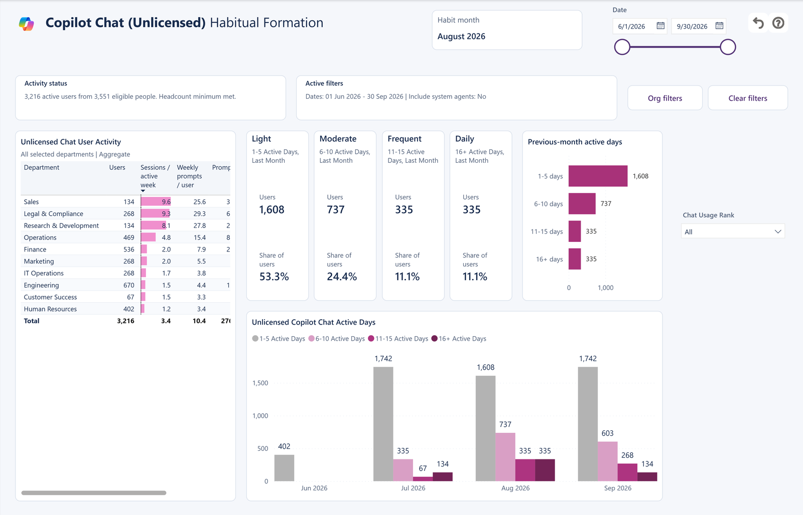

**What you'll see**
- **Habit month**, printed at the top.
- **Light, Moderate, Frequent and Daily cards,** with bars comparing the four groups.
- **Unlicensed chat user activity by department** for your whole selected period.
- **Unlicensed Copilot Chat active days:** the habit mix month by month.

<a href="#top">⬆️ Back to top</a>

## 16 · 📊 Copilot Chat (Unlicensed): Leaderboard

> **The question it answers:** *Which departments lead in Copilot Chat use, and how engaged are they?*

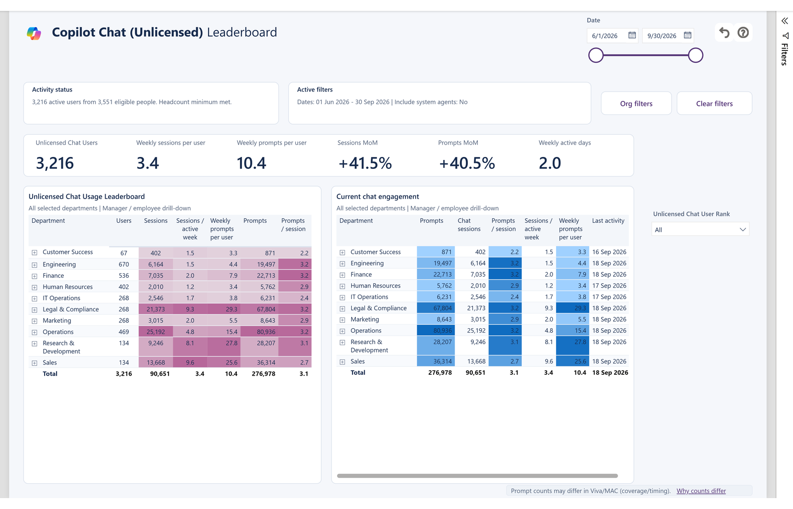

**What you'll see**
- **Unlicensed chat usage leaderboard by department:** users, prompts, prompts per session, sessions and weekly prompt/session comparisons.
- **Current chat engagement:** prompts, chat sessions, prompts per session, sessions per active week and last activity.

> ⚖️ **Good to know:** These pages count recorded chat only, not agents, Cowork or unclassified activity. Departments come first; individual people appear only with an approved setting.

<a href="#top">⬆️ Back to top</a>

---

## 17 · 📖 Metric Glossary & Guide

> **The question it answers:** *What does this number mean, and how should I read it?*

**What you'll see**
- **Filter by Page:** choose any of the 17 pages to see only the definitions you need. It opens on Copilot Usage Explorer.
- **Plain-language definitions** for every number and control. For example, *prompts* are requests, and *sessions* are conversations.
- **How to set Minimum Group Size,** both when you first open the template and later in Power BI Desktop.
- **The difference between grouping and access:** what a page displays versus who is allowed to see the data.

<a href="#top">⬆️ Back to top</a>

---

### 🚀 Ready to see your own data?

**[⬇️ Download the dashboard and set it up](README.md#-choose-your-edition)** &nbsp;·&nbsp; **[📘 Interpretation Guide](AI-in-One-v2.0.0-Interpretation-Guide.pdf)** &nbsp;·&nbsp; **[🎞️ Storyboard](AI-in-One-v2.0.0-Storyboard.pptx)**

Explore more free reports at **[aka.ms/Analytics-Hub](https://aka.ms/Analytics-Hub)**

Built and maintained by the **Microsoft Copilot Analytics team**.

### Explore the additional views

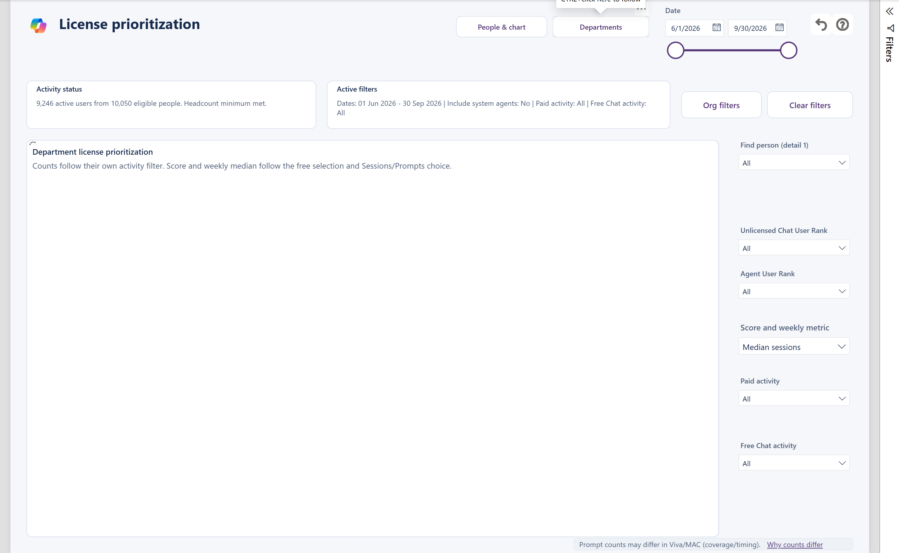

*Department prioritization, using synthetic snapshot data.*

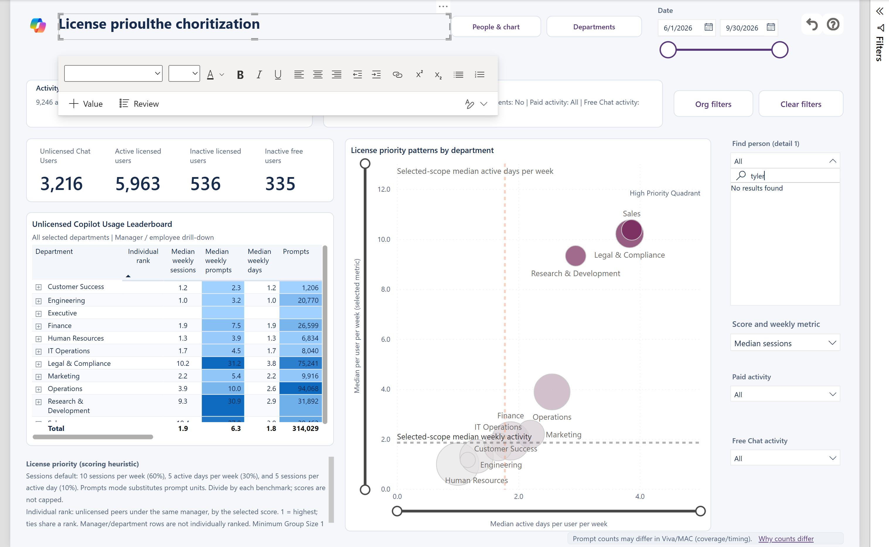

*Individual search is shown only with approved Minimum Group Size 1.*

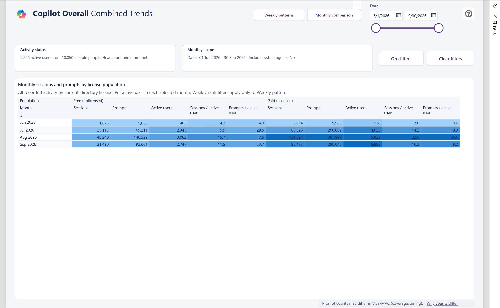

*Monthly comparison of the unchanged synthetic snapshot. Observed-history populations may overlap.*

### Supporting history definitions

- **License History Enabled:** Multiple observed states enable the history view. History Off and one-state seeds keep existing reporting behavior; access rules remain in force.
- **License Population in Period:** Distinct authorized people with an observed state in effect during the selected period. The earliest dated state also covers earlier events; parallel Unknown states are excluded when dated states exist. Paid/free periods can overlap, so distinct totals need not equal their sum.

- **User License Timeline:** One-line state: First seen timeline in the general Metric Glossary & Guide grouping. Existing person-row tooltips follow individual-detail and person-identity rules.
